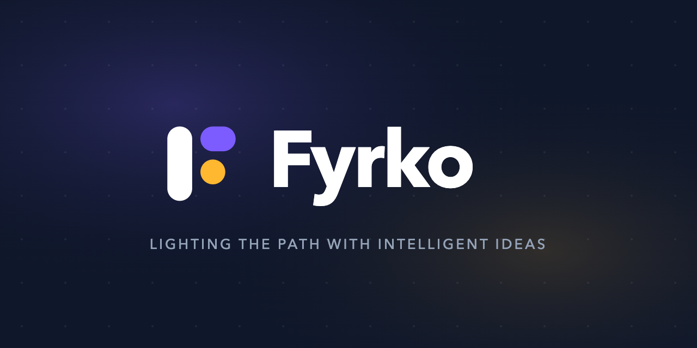

  

<h2 align="center">Lighting the path with intelligent ideas.</h2>

  <strong>Fyrko</strong> (from Nordic <em>fyr</em> — lighthouse, beacon) is an independent software &amp; AI studio crafting thoughtful developer tools, agentic workbenches, and focused productivity products.

---

### What We Focus On

- **Agentic Developer Workbenches** — Designing fast, high-leverage environments where engineers and AI agents collaborate seamlessly.
- **Knowledge & Reading Craft** — Turning scattered information into clear mental models, calm workflows, and lasting insight.
- **Minimalist Engineering** — Obsessing over clarity, tactile speed, and geometric precision in every interface we ship.

---

### Featured Open Source

| Project | Description | Stack |
| :--- | :--- | :--- |
| [**sparkcode**](https://github.com/fyrko-labs/sparkcode) | A deeply customized desktop coding-agent workbench built on T3 Code. | `TypeScript` |

---

  Built with clarity at <strong>Fyrko Labs</strong> · <code>#0F172A</code> · <code>#7C5CFF</code> · <code>#FFB830</code>

